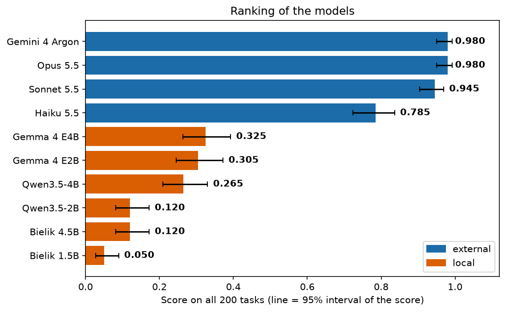
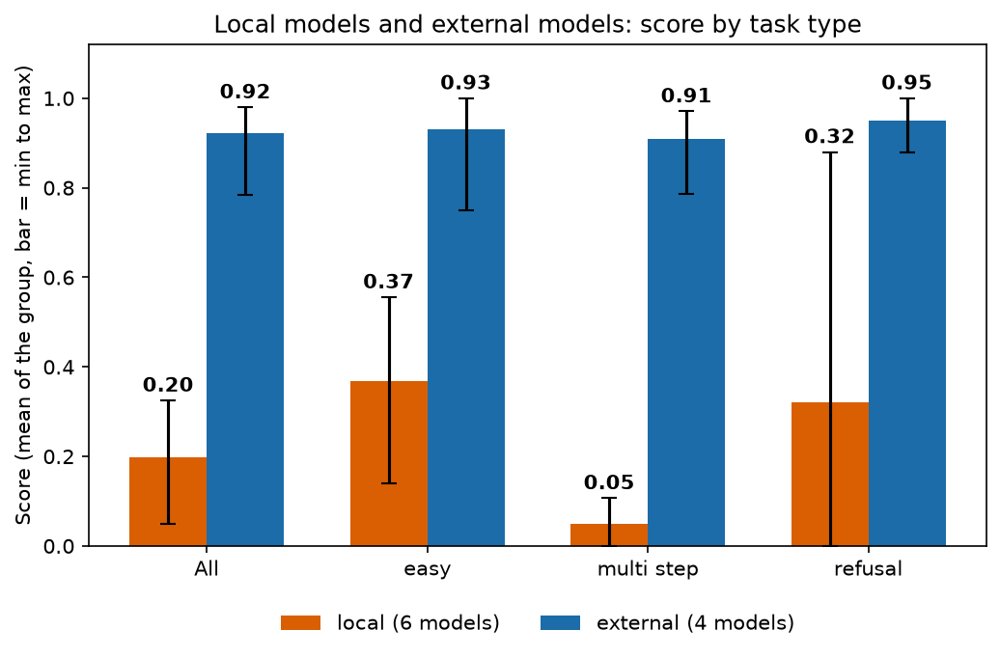
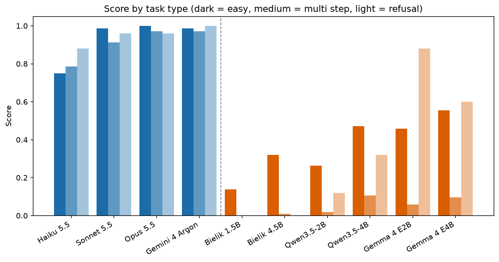
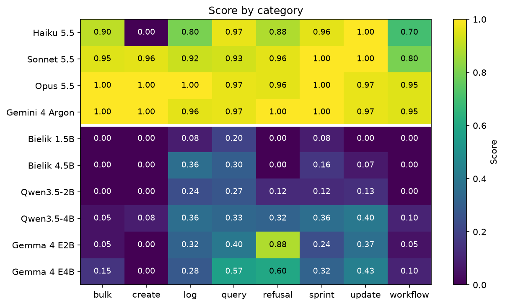
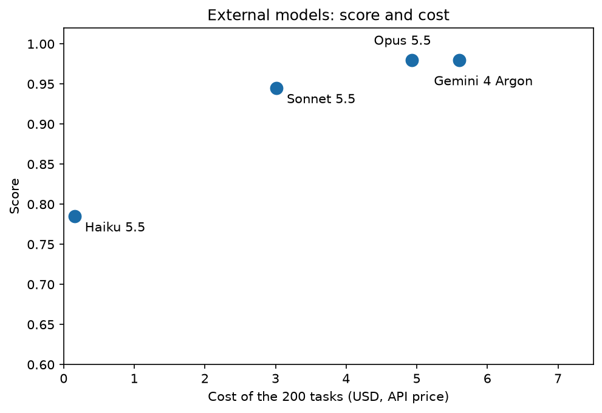
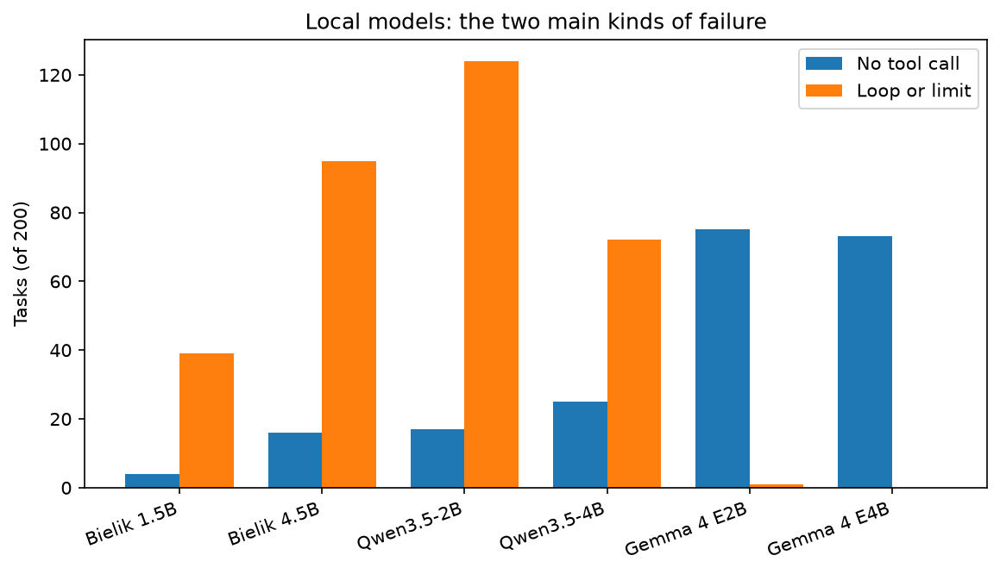

# Comparison of all baselines

This file compares ten models on the frozen test set of 200 tasks. The models do the tasks with the prompt `v3` and with no training. Each model has its own report in this folder. All numbers are in `results_baseline.csv`.

## How to read the score

The model gets 1 point for a task with the grade `correct` or `correct_refusal`. It gets 0 points for the grade `incorrect`. The score is the sum of the points divided by the number of tasks. Thus the score 0.500 means that the model solved half of the tasks.

- `correct`: the board has exactly the expected changes, or the answer has the expected information.
- `correct_refusal`: the task needs a refusal, the answer starts with `ODMOWA:`, and the board does not change.
- `incorrect`: all other results.

The test set has three types of task:

| Type | Tasks | Meaning |
|---|---|---|
| `easy` | 72 | The instruction gives the issue key. The task has one operation. |
| `multi_step` | 103 | The model must find the issue with a search, or it must do more than one operation. |
| `refusal` | 25 | No tool can do the request, or the request is not clear. The correct answer starts with `ODMOWA:`. |

## Ranking

The line on each bar is the Wilson 95% interval of the score. The formula uses only the score and the number of tasks (200). It treats each task as an independent trial.

- The interval shows how much the score can change on another set of similar tasks.
- If two lines overlap, the difference can be noise.
- All models solve the same tasks. A paired test of two models can find a difference that this interval hides.

## Local models and external models

The local models run on Kaggle GPUs. The external models run through the service of a provider. The figure shows the mean score of each group. The line on each bar shows the lowest and the highest model of the group.

## Score by task type

| Model | Group | All | `easy` | `multi_step` | `refusal` |
|---|---|---|---|---|---|
| Opus 5.5 | external | 0.980 | 1.000 | 0.971 | 0.960 |
| Gemini 4 Argon | external | 0.980 | 0.986 | 0.971 | 1.000 |
| Sonnet 5.5 | external | 0.945 | 0.986 | 0.913 | 0.960 |
| Haiku 5.5 | external | 0.785 | 0.750 | 0.786 | 0.880 |
| Gemma 4 E4B | local | 0.325 | 0.556 | 0.097 | 0.600 |
| Gemma 4 E2B | local | 0.305 | 0.458 | 0.058 | 0.880 |
| Qwen3.5-4B | local | 0.265 | 0.472 | 0.107 | 0.320 |
| Bielik 4.5B | local | 0.120 | 0.319 | 0.010 | 0.000 |
| Qwen3.5-2B | local | 0.120 | 0.264 | 0.019 | 0.120 |
| Bielik 1.5B | local | 0.050 | 0.139 | 0.000 | 0.000 |

## Score by category

The category tells what the user wants. Each task has one category. The number of tasks is in brackets.

| Category | Meaning |
|---|---|
| `bulk` (20) | The same change for many issues of a filter. |
| `create` (25) | A new issue. |
| `log` (25) | A comment or a worklog. |
| `query` (30) | Information only. The board does not change. |
| `refusal` (25) | A request that the model must refuse. |
| `sprint` (25) | A change of the sprint of an issue, or a move to the backlog. |
| `update` (30) | One change of one issue, for example the assignee or the status. |
| `workflow` (20) | Different operations in one task, for example close, log and comment. |

| Model | `bulk` | `create` | `log` | `query` | `refusal` | `sprint` | `update` | `workflow` |
|---|---|---|---|---|---|---|---|---|
| Opus 5.5 | 1.000 | 1.000 | 1.000 | 0.967 | 0.960 | 1.000 | 0.967 | 0.950 |
| Gemini 4 Argon | 1.000 | 1.000 | 0.960 | 0.967 | 1.000 | 1.000 | 0.967 | 0.950 |
| Sonnet 5.5 | 0.950 | 0.960 | 0.920 | 0.933 | 0.960 | 1.000 | 1.000 | 0.800 |
| Haiku 5.5 | 0.900 | 0.000 | 0.800 | 0.967 | 0.880 | 0.960 | 1.000 | 0.700 |
| Gemma 4 E4B | 0.150 | 0.000 | 0.280 | 0.567 | 0.600 | 0.320 | 0.433 | 0.100 |
| Gemma 4 E2B | 0.050 | 0.000 | 0.320 | 0.400 | 0.880 | 0.240 | 0.367 | 0.050 |
| Qwen3.5-4B | 0.050 | 0.080 | 0.360 | 0.333 | 0.320 | 0.360 | 0.400 | 0.100 |
| Bielik 4.5B | 0.000 | 0.000 | 0.360 | 0.300 | 0.000 | 0.160 | 0.067 | 0.000 |
| Qwen3.5-2B | 0.000 | 0.000 | 0.240 | 0.267 | 0.120 | 0.120 | 0.133 | 0.000 |
| Bielik 1.5B | 0.000 | 0.000 | 0.080 | 0.200 | 0.000 | 0.080 | 0.000 | 0.000 |

## Main points

- The best local model (Gemma 4 E4B, 0.325) is far below the weakest external model (Haiku 5.5, 0.785). The gap is 0.46.
- The gap is largest for `multi_step`. The best local score is 0.107. Opus 5.5 and Argon have 0.971.
- No local model solves the `create` category. The best score is 0.080.
- Haiku 5.5 also has the score 0 for `create`. In 23 of 25 `create` tasks it made no tool call. It asked the user for the project key.
- Opus 5.5 and Argon have the same score. Argon needs about 9 times more task time and costs more.
- The high `refusal` score of the Gemma models is not a good result. They refuse too often (see the report of each model).
- The external models show that the tasks are possible. The scores 0.945 and 0.980 are the target for SFT and RL.

## Behavior, tokens and cost

| Model | Task time (s) | No call | Loop or limit | Input tokens | Output tokens | Cost (USD) |
|---|---|---|---|---|---|---|
| Opus 5.5 | 1219 | 6 | 0 | 5 599 109 | 93 340 | 4.93 |
| Gemini 4 Argon | 11276 | 1 | 0 | 4 397 528 | 71 436 | 5.60 |
| Sonnet 5.5 | 806 | 9 | 0 | 5 610 669 | 77 762 | 3.02 |
| Haiku 5.5 | 757 | 34 | 0 | 5 005 711 | 124 154 | 0.16 |
| Gemma 4 E4B | 2998 | 73 | 0 | 1 816 652 | 12 986 | local |
| Gemma 4 E2B | 1818 | 75 | 1 | 1 629 697 | 13 246 | local |
| Qwen3.5-4B | 10431 | 25 | 72 | 3 812 523 | 105 359 | local |
| Bielik 4.5B | 11851 | 16 | 95 | 2 709 076 | 100 765 | local |
| Qwen3.5-2B | 12352 | 17 | 124 | 2 248 680 | 220 032 | local |
| Bielik 1.5B | 3618 | 4 | 39 | 2 285 610 | 79 446 | local |

- "Task time" is the sum of the times of the 200 tasks, as if the tasks ran one after another.
- "No call" counts the tasks with no tool call.
- "Loop or limit" counts the tasks that stop at `loop_same`, `loop_errors` or `max_steps`.
- "Input tokens" is the sum for all calls of all tasks. Each call sends the full history again, so this number is much larger than the output.
- The local models have no cost in USD, because we do not pay for the tokens of these models.
- The tokens of different models are not the same unit. Each model has its own tokenizer.
