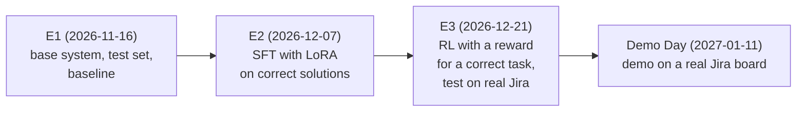
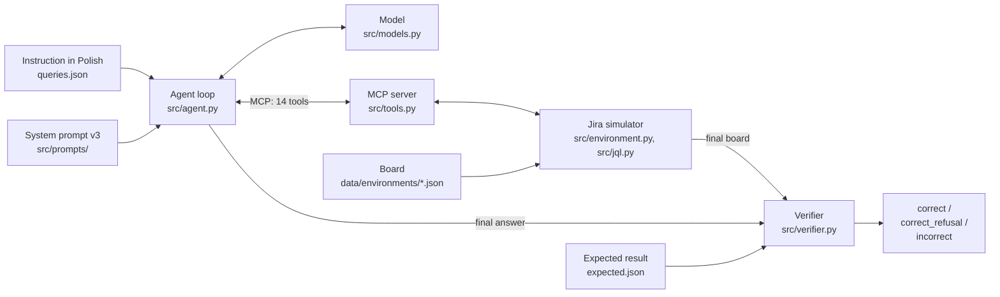
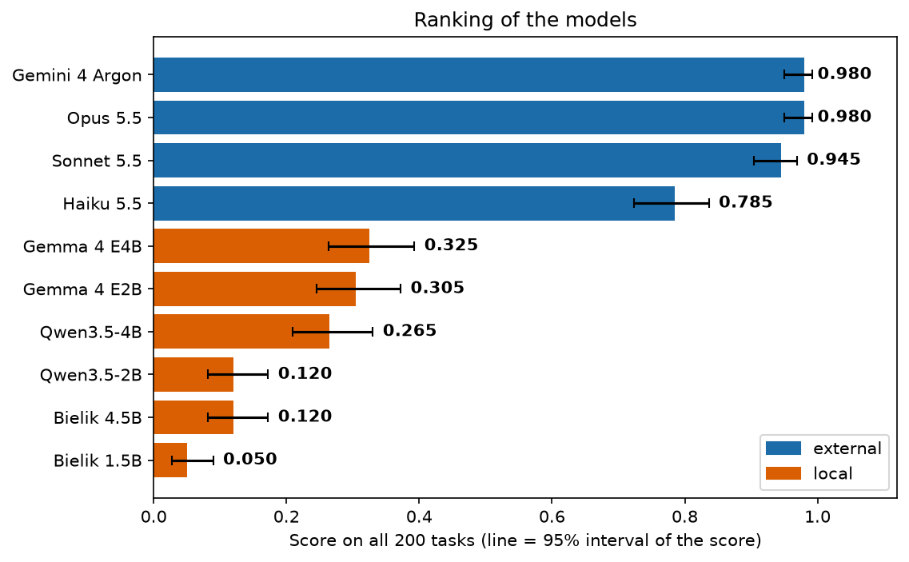
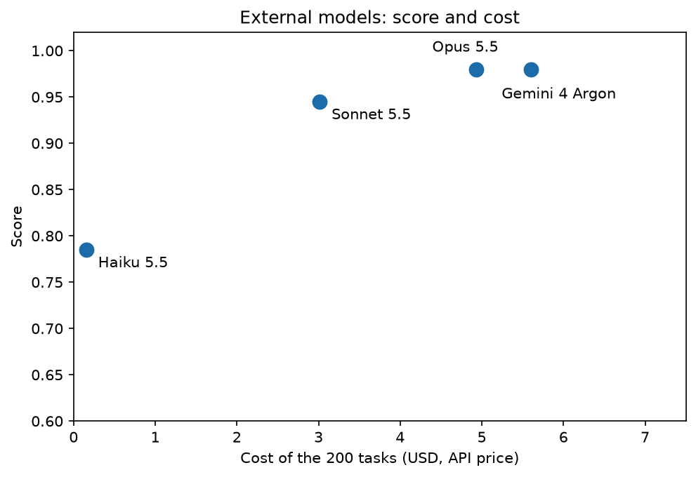

# E1: Base system, test set and baseline

This report is the result of the milestone E1 (2026-11-16). The course asks for these parts:

| Requirement of E1 | Where it is | Section |
|---|---|---|
| The system operates end to end on the selected data. | Jira simulator, MCP server, agent loop and verifier in `src/` | [System](#system) |
| For fine-tuning: a base model and a prompt. | Six local base models, the prompt `v3` | [Models and prompt](#models-and-prompt) |
| A test set: input and expected result. | 200 frozen tasks in `data/tasks/test/` | [Test set](#test-set) |
| A baseline score. | Ten models on the same test set | [Baseline results](#baseline-results) |

## Project

### Goal

We train a small open language model to do tasks in a project management system (Jira). The model gets an instruction in Polish, for example:

> Proszę przypisać Michałowi wszystkie nieprzypisane bugi z etykietą security.

The model does the task with the tools of an MCP server. It reads the board, finds the issues and the persons, and makes the changes.

### Research question

Can a small local model, with fine-tuning for one task, come near a large API model? The small model must have a much lower cost. The data of the company must not go outside the company.

A large API model is only a reference point. The improvement must come from the method, not from a larger model. The size of the model is not a variable in the grade.

### Plan

The model learns in two steps after E1. First it learns from correct examples (SFT). Then it learns from a reward for a correct task (RL).



| Milestone | Date | Deliverable |
|---|---|---|
| E1 | 2026-11-16 | The base system, the test set with the expected results, and the baseline score. |
| E2 | 2026-12-07 | LoRA fine-tuning on correct solutions. The score before and after on the same test set. |
| E3 | 2026-12-21 | RL with a reward for a correct task. A comparison with E2. A test on real Jira Cloud. |
| Demo Day | 2027-01-11 | A demo on a real Jira board and the before/after results. |

## System

### Flow of one task



1. The simulator loads one board: a Jira project with issues, persons and sprints.
2. The agent loop gives the instruction, the system prompt and the tool schemas to the model.
3. The model sends a tool call. The MCP server runs the call on the simulator and returns the result.
4. The loop continues until the model gives an answer without a tool call, or until a limit stops it.
5. The verifier compares the final board and the answer with the expected result.

### Components

| Component | File | Function |
|---|---|---|
| Simulator | `src/environment.py` | Keeps the state of one board: issues, persons, sprints, comments and worklogs. |
| JQL | `src/jql.py` | Runs the JQL queries of `jira_search` on the simulator. |
| MCP server | `src/tools.py` | Gives the 14 tools to the model. The tools have the schemas and the error texts of the real server. |
| Agent loop | `src/agent.py` | Runs the conversation of the model with the tools. It stops at an answer or at a limit. |
| Models | `src/models.py` | One interface for local models (`transformers`) and for API models. |
| Prompts | `src/prompts/` | The system prompt and the tool format of each model family. |
| Tasks | `src/tasks.py` | Reads the task files of a split. |
| Verifier | `src/verifier.py` | Gives the grade of a task. |
| Evaluation | `src/evaluate.py` | Runs a split, writes the results and writes the report of a run. |

The names in the code do not depend on the domain (`environment`, `task`, `tool`). Thus the domain can change.

### Tools

The tools have the same contract as `mcp-atlassian` 0.23.1, an MCP server for real Jira. Thus the same model can work with real Jira at E3 without a change. The team tested all 14 tools on a Jira Cloud site. The simulator gives the same results and the same errors as this site. `docs/JIRA_TOOLS.md` has the full contracts.

| Read tools | Write tools |
|---|---|
| `jira_search` (JQL) | `jira_create_issue` |
| `jira_get_issue` | `jira_update_issue` |
| `jira_search_assignable_users` | `jira_transition_issue` |
| `jira_get_agile_boards` | `jira_add_comment` |
| `jira_get_sprints_from_board` | `jira_add_worklog` |
| `jira_get_transitions` | `jira_add_issues_to_sprint` |
| `jira_get_worklog` | `jira_move_issues_to_backlog` |

### Verifier

The verifier is a program, not a model. It compares the changes of the board with the expected changes. A task is `correct` only if the board has all expected changes and no other changes. A `query` task must give the expected value in the answer and must not change the board.

| Grade | Rule |
|---|---|
| `correct` | The board has exactly the expected changes, or the answer has the expected information. |
| `correct_refusal` | The task needs a refusal, the answer starts with `ODMOWA:`, and the board does not change. |
| `incorrect` | All other results. |

## Test set

`docs/TASKS.md` describes the full test set and the rules for its review.

### Data

All test boards belong to one invented company: JayWalk, a brand of sport shoes with an online shop. Each board is the Jira project of one team. The data is synthetic. It has no personal data. All e-mail addresses use `@example.com`.

| Board | Project key | Team |
|---|---|---|
| `test-web` | WEB | Online shop |
| `test-app` | APP | Mobile app |
| `test-api` | API | API for partners |
| `test-data` | DATA | Data and reports |
| `test-ops` | OPS | Infrastructure |

Each board has 40 issues, 7 or 8 persons and 4 sprints (1 closed, 1 active, 2 future). Each board also has traps:

- One person who is not active (a former employee).
- Two persons with the same first name.
- Issues in Polish and in English.
- One `Cancelled` issue.

### Tasks

The test set has 200 tasks, 40 on each board.

| Category | `easy` | `multi_step` | `refusal` | Total |
|---|---|---|---|---|
| `query` | 15 | 15 | | 30 |
| `update` | 15 | 15 | | 30 |
| `log` | 15 | 10 | | 25 |
| `create` | 15 | 10 | | 25 |
| `sprint` | 12 | 13 | | 25 |
| `bulk` | | 20 | | 20 |
| `workflow` | | 20 | | 20 |
| `refusal` | | | 25 | 25 |
| **Total** | **72** | **103** | **25** | **200** |

The refusal tasks have four kinds:

| Kind | Meaning | Count |
|---|---|---|
| `no_tool` | No tool does the operation, for example the deletion of an issue. | 7 |
| `missing_entity` | The person, the issue or the sprint does not exist, or the person is not active. | 7 |
| `ambiguous` | More than one person or issue matches the words of the user. | 6 |
| `out_of_domain` | The request is not about the project work. | 5 |

Each instruction has an author: a person of the board with a fixed style of writing. There are 16 authors. Some authors write short commands, some write long polite text, and some mix Polish and English. The model does not get the name of the author.

### Input and expected result

Each task has four files in `data/tasks/test/`. The field `id` connects them.

| File | Content |
|---|---|
| `queries.json` | The input: the author and the instruction. |
| `expected.json` | The expected result: the board, the category, the difficulty, and the expected changes or the expected answer. |
| `solutions.json` | A reference solution: the correct tool calls and the answer. |
| `personas.json` | The descriptions of the authors. |

Three examples:

| Task | Instruction (input) | Expected result |
|---|---|---|
| `test-003` (`query`, `easy`) | Jaki priorytet ma obecnie WEB-19? Proszę o krótką odpowiedź. | The answer has the value `Highest`. The board does not change. |
| `test-028` (`bulk`, `multi_step`) | Proszę przypisać Michałowi wszystkie nieprzypisane bugi z etykietą security. | `WEB-19` and `WEB-33` have the assignee `Michał Krawczyk`. |
| `test-120` (`refusal`) | polecisz jakiś dobry pub w Warszawie na spotkanie z partnerami? | The answer starts with `ODMOWA:`. The board does not change. |

The reference solution of `test-028` shows the steps that a `multi_step` task needs:

| Step | Tool call |
|---|---|
| 1 | `jira_search`: `project = WEB AND type = Bug AND labels = security AND assignee is EMPTY` |
| 2 | `jira_search_assignable_users`: `Michał` |
| 3 | `jira_update_issue`: `WEB-33`, assignee `Michał Krawczyk` |
| 4 | `jira_update_issue`: `WEB-19`, assignee `Michał Krawczyk` |

### Quality of the test set

- A test runs each reference solution on the simulator. All 200 solutions get the grade `correct` or `correct_refusal`.
- Both team members did a review of all instructions. The review corrected 30 instructions.
- The test set is frozen since 2026-11-05. `tests/test_tasks.py` compares the task files and the test boards with stored checksums.
- The train set and the validation set use other companies and other domains. A test checks that no board, instruction, issue summary or person occurs in two splits.

## Models and prompt

### Local models

All six local models have a license that permits commercial use. The weights are frozen as private Kaggle Models, so each run uses the same version. `docs/MODELS.md` has the details.

| Model | Family | Size |
|---|---|---|
| `Qwen/Qwen3.5-2B` | Qwen3.5 | 2B |
| `Qwen/Qwen3.5-4B` | Qwen3.5 | 4B |
| `speakleash/Bielik-1.5B-v3.0-Instruct` | Bielik v3 | 1.6B |
| `speakleash/Bielik-4.5B-v3.0-Instruct` | Bielik v3 | 4.6B |
| `google/gemma-4-E2B-it` | Gemma 4 | 2.3B effective |
| `google/gemma-4-E4B-it` | Gemma 4 | 4.5B effective |

### External models

Four API models are the reference point: Opus 5.5, Sonnet 5.5, Haiku 5.5 and Gemini 4 Argon. They show that the tasks are possible.

### Settings of a run

All runs use the same settings. The config of each run is in its folder in `jobs/runs/`.

| Setting | Value |
|---|---|
| System prompt | `v3` (`src/prompts/system-v3.md`) |
| Decoding | Greedy (`do_sample=False`) for local models, temperature 0 for API models |
| Maximum tool calls | 25 |
| Loop limit | 3 identical calls one after another |
| Error limit | 5 errors |
| Maximum new tokens | 1024 for each output |
| Thinking mode | Off |
| Hardware of the local models | Kaggle, NVIDIA Tesla T4, `float16` |

The prompt tells the model these rules:

- Find all facts with the tools.
- Search for an issue when the user does not give its key.
- Use the English names of statuses, types and priorities.
- Find a person with `jira_search_assignable_users`.
- Refuse with `ODMOWA:` only after a check with the tools.

## Baseline results

The rest of this section has the full comparison of the baselines (`data/results/baseline/report-all-baseline-comparison.md`). The models do the tasks with the prompt `v3` and with no training. Each model has its own report in `data/results/baseline/`. All numbers are in `results_baseline.csv`.

### How to read the score

The model gets 1 point for a task with the grade `correct` or `correct_refusal`. It gets 0 points for the grade `incorrect`. The score is the sum of the points divided by the number of tasks. Thus the score 0.500 means that the model solved half of the tasks.

- `correct`: the board has exactly the expected changes, or the answer has the expected information.
- `correct_refusal`: the task needs a refusal, the answer starts with `ODMOWA:`, and the board does not change.
- `incorrect`: all other results.

The test set has three types of task:

| Type | Tasks | Meaning |
|---|---|---|
| `easy` | 72 | The instruction gives the issue key. The task has one operation. |
| `multi_step` | 103 | The model must find the issue with a search, or it must do more than one operation. |
| `refusal` | 25 | No tool can do the request, or the request is not clear. The correct answer starts with `ODMOWA:`. |

### Ranking



The line on each bar is the Wilson 95% interval of the score. The formula uses only the score and the number of tasks (200). It treats each task as an independent trial.

- The interval shows how much the score can change on another set of similar tasks.
- If two lines overlap, the difference can be noise.
- All models solve the same tasks. A paired test of two models can find a difference that this interval hides.

### Local models and external models

The local models run on Kaggle GPUs. The external models run through the service of a provider. The figure shows the mean score of each group. The line on each bar shows the lowest and the highest model of the group.


### Score by task type

| Model | Group | All | `easy` | `multi_step` | `refusal` |
|---|---|---|---|---|---|
| Opus 5.5 | external | 0.980 | 1.000 | 0.971 | 0.960 |
| Gemini 4 Argon | external | 0.980 | 0.986 | 0.971 | 1.000 |
| Sonnet 5.5 | external | 0.945 | 0.986 | 0.913 | 0.960 |
| Haiku 5.5 | external | 0.785 | 0.750 | 0.786 | 0.880 |
| Gemma 4 E4B | local | 0.325 | 0.556 | 0.097 | 0.600 |
| Gemma 4 E2B | local | 0.305 | 0.458 | 0.058 | 0.880 |
| Qwen3.5-4B | local | 0.265 | 0.472 | 0.107 | 0.320 |
| Bielik 4.5B | local | 0.120 | 0.319 | 0.010 | 0.000 |
| Qwen3.5-2B | local | 0.120 | 0.264 | 0.019 | 0.120 |
| Bielik 1.5B | local | 0.050 | 0.139 | 0.000 | 0.000 |


### Score by category

The category tells what the user wants. Each task has one category. The number of tasks is in brackets.

| Category | Meaning |
|---|---|
| `bulk` (20) | The same change for many issues of a filter. |
| `create` (25) | A new issue. |
| `log` (25) | A comment or a worklog. |
| `query` (30) | Information only. The board does not change. |
| `refusal` (25) | A request that the model must refuse. |
| `sprint` (25) | A change of the sprint of an issue, or a move to the backlog. |
| `update` (30) | One change of one issue, for example the assignee or the status. |
| `workflow` (20) | Different operations in one task, for example close, log and comment. |

| Model | `bulk` | `create` | `log` | `query` | `refusal` | `sprint` | `update` | `workflow` |
|---|---|---|---|---|---|---|---|---|
| Opus 5.5 | 1.000 | 1.000 | 1.000 | 0.967 | 0.960 | 1.000 | 0.967 | 0.950 |
| Gemini 4 Argon | 1.000 | 1.000 | 0.960 | 0.967 | 1.000 | 1.000 | 0.967 | 0.950 |
| Sonnet 5.5 | 0.950 | 0.960 | 0.920 | 0.933 | 0.960 | 1.000 | 1.000 | 0.800 |
| Haiku 5.5 | 0.900 | 0.000 | 0.800 | 0.967 | 0.880 | 0.960 | 1.000 | 0.700 |
| Gemma 4 E4B | 0.150 | 0.000 | 0.280 | 0.567 | 0.600 | 0.320 | 0.433 | 0.100 |
| Gemma 4 E2B | 0.050 | 0.000 | 0.320 | 0.400 | 0.880 | 0.240 | 0.367 | 0.050 |
| Qwen3.5-4B | 0.050 | 0.080 | 0.360 | 0.333 | 0.320 | 0.360 | 0.400 | 0.100 |
| Bielik 4.5B | 0.000 | 0.000 | 0.360 | 0.300 | 0.000 | 0.160 | 0.067 | 0.000 |
| Qwen3.5-2B | 0.000 | 0.000 | 0.240 | 0.267 | 0.120 | 0.120 | 0.133 | 0.000 |
| Bielik 1.5B | 0.000 | 0.000 | 0.080 | 0.200 | 0.000 | 0.080 | 0.000 | 0.000 |


### Main points

- The best local model (Gemma 4 E4B, 0.325) is far below the weakest external model (Haiku 5.5, 0.785). The gap is 0.46.
- The gap is largest for `multi_step`. The best local score is 0.107. Opus 5.5 and Argon have 0.971.
- No local model solves the `create` category. The best score is 0.080.
- Haiku 5.5 also has the score 0 for `create`. In 23 of 25 `create` tasks it made no tool call. It asked the user for the project key.
- Opus 5.5 and Argon have the same score. Argon needs about 9 times more task time and costs more.
- The high `refusal` score of the Gemma models is not a good result. They refuse too often (see the report of each model).
- The external models show that the tasks are possible. The scores 0.945 and 0.980 are the target for SFT and RL.

### Behavior, tokens and cost




| Model | Task time (s) | No call | Loop or limit | Input tokens | Output tokens | Cost (USD) |
|---|---|---|---|---|---|---|
| Opus 5.5 | 1219 | 6 | 0 | 5 599 109 | 93 340 | 4.93 |
| Gemini 4 Argon | 11276 | 1 | 0 | 4 397 528 | 71 436 | 5.60 |
| Sonnet 5.5 | 806 | 9 | 0 | 5 610 669 | 77 762 | 3.02 |
| Haiku 5.5 | 757 | 34 | 0 | 5 005 711 | 124 154 | 0.16 |
| Gemma 4 E4B | 2998 | 73 | 0 | 1 816 652 | 12 986 | local |
| Gemma 4 E2B | 1818 | 75 | 1 | 1 629 697 | 13 246 | local |
| Qwen3.5-4B | 10431 | 25 | 72 | 3 812 523 | 105 359 | local |
| Bielik 4.5B | 11851 | 16 | 95 | 2 709 076 | 100 765 | local |
| Qwen3.5-2B | 12352 | 17 | 124 | 2 248 680 | 220 032 | local |
| Bielik 1.5B | 3618 | 4 | 39 | 2 285 610 | 79 446 | local |

- "Task time" is the sum of the times of the 200 tasks, as if the tasks ran one after another.
- "No call" counts the tasks with no tool call.
- "Loop or limit" counts the tasks that stop at `loop_same`, `loop_errors` or `max_steps`.
- "Input tokens" is the sum for all calls of all tasks. Each call sends the full history again, so this number is much larger than the output.
- The local models have no cost in USD, because we do not pay for the tokens of these models.
- The tokens of different models are not the same unit. Each model has its own tokenizer.

## Error analysis

The team read the tool calls of the failed tasks of each local model. The report of each model has the details and a `Why` cell for each task. The same errors occur in most models:

| Error | Example from the reports | Models |
|---|---|---|
| A made-up project, board or key | More than 70 tasks of Qwen3.5-4B used a project key that does not exist, for example `PROJ`. | Most local models |
| No tool call, a question to the user | 73 tasks of Gemma 4 E4B end with no tool call, often with a request for a key. | Gemma 4 E2B, Gemma 4 E4B |
| Invalid JQL | 74 tasks of Qwen3.5-2B used `=`, `contains` or `LIKE` on a text field. | Qwen3.5-2B, Bielik 1.5B, Bielik 4.5B |
| No second search after an empty result | 67 tasks of Qwen3.5-4B stopped at the rule `loop_same`. | Most local models |
| A guessed id | Qwen3.5-4B guessed the transition id 3 in 7 tasks. | Most local models |
| Wrong use of the tool contract | Bielik 4.5B sent many calls in one output in 118 tasks. | Bielik 1.5B, Bielik 4.5B |
| A wrong refusal | Gemma 4 E2B refused 58 of 175 possible tasks. Bielik passed no refusal task. | All local models |

Thus the local models must learn these skills:

1. Find the project with `jira_get_agile_boards` before `jira_create_issue` or a sprint change.
2. Search for an issue with a short keyword. After an empty result, search again with another word.
3. Read each id from a tool result.
4. Write valid JQL.
5. Use only the 14 tools and their arguments.
6. Refuse with `ODMOWA:` only when no tool can do the request.

## Next steps

- **E2 (SFT).** The train set has 1000 tasks on 25 boards of 5 other companies. The validation set has 120 tasks on 3 boards of one more company. The reference solutions show the skills of the error analysis. For example, 585 train tasks find the project with `jira_get_agile_boards` first. 100 train tasks search again after an empty result. All six models get a LoRA adapter. The team then measures them on the same frozen test set.
- **E3 (RL).** The method is GRPO with the DAPO changes in TRL, with a LoRA adapter. The reward is 1 for a correct task and 0 for other tasks. RL starts from the SFT models. After RL, the models get a test on real Jira Cloud.

## Reproduction

To run the tests of the system and of the data, run this command in the root folder of the repository:

```bash
uv run --no-project python -m pytest
```

To make the local environment, obey the section "Environment" of `AGENTS.md`. The baseline runs are Kaggle jobs. `jobs/JOBS.md` lists them with their configs, commits and results.
