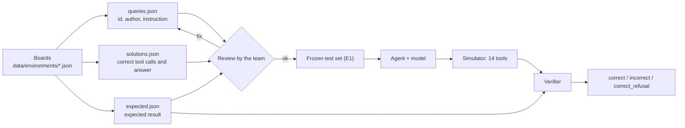

# Task set

This file describes the task set: the boards, the tasks, the files and the rules for the review. The team uses it for the review of the data and for the report.

Status on 2026-11-03: the test set (200 tasks) exists. It is not frozen yet. The train set does not exist yet.

## Flow

The data comes first. The code of the simulator and of the verifier comes later, in a separate OpenSpec change. A test of that change runs each reference solution on the simulator and compares the result with `expected.json`. Thus the test checks the simulator and the data together.

## Company

All test boards belong to one invented company: **JayWalk**, a brand of sport shoes with an online shop. Each board is the Jira project of one team.

| Board | Project key | Team | Typical issues |
|---|---|---|---|
| `test-web` | WEB | Online shop | cart, BLIK payments, customer panel, SEO |
| `test-app` | APP | Mobile app | push notifications, drops, crashes, login |
| `test-api` | API | API for partners | rate limits, webhooks, stock levels |
| `test-data` | DATA | Data and reports | ETL, dashboards, data quality, privacy |
| `test-ops` | OPS | Infrastructure | Kubernetes, backups, certificates, CI |

The train boards will use other companies and other domains. Then the test shows if the model can work with Jira, not if it remembers the data.

## Boards

Each board is one JSON file in `data/environments/`. A board has the same content as one Jira Cloud project:

| Part | Content |
|---|---|
| `project` | key and name |
| `board` | id, name, type `scrum` |
| `persons` | 7 or 8 persons: account id, display name, e-mail (`@example.com`), active flag |
| `sprints` | 1 closed, 1 active, 2 future sprints |
| `issues` | 40 issues with the fields of Jira, comments and worklogs |

Each test board has these traps:

- One person who is not active (a former employee). This person is not in the result of `jira_search_assignable_users`.
- Two persons with the same first name, for example Anna Wróbel and Anna Sikora.
- Issues in Polish and in English.
- One `Cancelled` issue. On this Jira site, the status category of `Cancelled` is `In Progress`, not `Done`.

The values of the fields are the values of the Jira Cloud site with the English language:

| Field | Values |
|---|---|
| Type | `Task`, `Bug`, `Story` |
| Status | `Backlog`, `In Progress`, `In review`, `Done`, `Cancelled` |
| Transition id | `Backlog` 11, `In Progress` 21, `In review` 31, `Cancelled` 41, `Done` 51 |
| Priority | `Highest`, `High`, `Medium`, `Low`, `Lowest` |

## Categories

| Category | What the user wants | Example | Result that the verifier checks |
|---|---|---|---|
| `query` | information, no change | "Ile godzin poszło już na WEB-5?" | answer + no change |
| `update` | one change of one issue | "Dajcie WEB-7 Michałowi." | changes of the board |
| `log` | a comment or a worklog | "zaloguj 2h na WEB-12, opis: poprawki aria" | new comment or worklog |
| `create` | a new issue | "Nowy bug: Brak ceny w EUR na ekranie produktu. Priorytet High." | new issue with its fields |
| `sprint` | a sprint or the backlog | "APP-14 wywal do backlogu" | sprint of the issues |
| `bulk` | the same change for many issues of a filter | "Wszystkie nieprzypisane bugi z labelem security przypisz Michałowi." | changes of many issues |
| `workflow` | different operations together | "skończyłem WEB-32: zamknij go, zaloguj 30m i napisz w komentarzu ..." | all changes together |
| `refusal` | an operation that is not possible or not clear | "Usuńcie WEB-37." | `ODMOWA:` + no change |

## Difficulty

| Difficulty | Meaning |
|---|---|
| `easy` | The instruction gives the issue key. The task has one operation. One operation can need more than one tool call, for example `jira_get_transitions` and then `jira_transition_issue`. |
| `multi_step` | The model must find the issue with a search, or it must do more than one operation. |
| `refusal` | The correct answer starts with `ODMOWA:` and the board does not change. |

Counts of the test set:

| Category | `easy` | `multi_step` | `refusal` | Total |
|---|---|---|---|---|
| `query` | 15 | 15 | | 30 |
| `update` | 15 | 15 | | 30 |
| `log` | 15 | 10 | | 25 |
| `create` | 15 | 10 | | 25 |
| `sprint` | 12 | 13 | | 25 |
| `bulk` | | 20 | | 20 |
| `workflow` | | 20 | | 20 |
| `refusal` | | | 25 | 25 |
| **Total** | **72 (36%)** | **103 (51.5%)** | **25 (12.5%)** | **200** |

Each board has 40 tasks.

Kinds of refusal:

| Kind | Meaning | Example | Count |
|---|---|---|---|
| `no_tool` | No tool does the operation. | delete an issue, close a sprint, link issues, send an e-mail | 7 |
| `missing_entity` | The person, the issue or the sprint does not exist, or the person is not active. | "daj WEB-26 Pawłowi" (Paweł is a former employee) | 7 |
| `ambiguous` | More than one person or issue matches the words of the user. | "Daj WEB-39 Ani." (two persons with the name Anna) | 6 |
| `out_of_domain` | The request is not about the project work. | "jaki jest dzis kurs dolara?" | 5 |

## Authors

Each instruction has an author. An author is a person of the board, and all instructions of one author have the same style. `data/tasks/test/personas.json` has the full descriptions.

| Author | Board | Role | Style |
|---|---|---|---|
| Rudolf Igor | test-web | Product owner | Says awkward things: too much private detail, strange remarks about colleagues, odd suspicions. The request is clear. |
| Ewa Mazur | test-web | QA lead | Precise and polite, uses keys and exact status names. |
| Daniel Brooks | test-web | Frontend developer from Ireland | Polish with English words, lower case, "pls", "thx". |
| Zofia Kaczmarek | test-web | Customer service lead | Tells what customers say, does not know issue keys. |
| Marta Pawlak | test-app | Product manager | Very short commands without greetings. |
| Kamil Dudek | test-app | Android developer | Casual spoken Polish, sometimes no Polish letters. |
| Sophie Grant | test-app | iOS developer from the UK | Very polite, thanks for each action. |
| Tomasz Baran | test-api | Backend tech lead | Technical background first, then the exact action. |
| Oliver Hayes | test-api | Integration engineer from the UK | Polish and English in one sentence. |
| Natalia Zając | test-api | Scrum master | Talks about the sprint and the team, friendly. |
| Joanna Kurek | test-data | Head of analytics | Business context first: management, reports, deadlines. |
| Igor Kwiatkowski | test-data | Data engineer | One short line, minimum of words. |
| Priya Raman | test-data | Data scientist from India | Polite Polish with English data terms. |
| Karolina Bielecka | test-ops | Head of infrastructure | Urgent tone, capital letters and exclamation marks. |
| Wojciech Michalak | test-ops | Senior system administrator | Formal, old style: "Uprzejmie proszę". |
| Ethan Cole | test-ops | Site reliability engineer | Mostly English jargon inside Polish sentences. |

The model does not get the name of the author. Thus an instruction that needs the identity of the author says the name, for example "przypisz do mnie, Wojciecha Michalaka".

## Files

All files are in `data/tasks/test/`. The field `id` connects the files.

| File | Content | Who reads it |
|---|---|---|
| `queries.json` | `id`, `author`, `instruction`: the text of the user | the agent, the team |
| `solutions.json` | `id`, `calls` (the correct tool calls in order), `answer` (a correct final answer) | SFT, the team |
| `expected.json` | `id`, `board`, `category`, `difficulty`, and the expected result | the verifier |
| `personas.json` | the authors and their styles | the team |

The old file `tasks.jsonl` belongs to the old simulator. The OpenSpec change of the new simulator removes it.

### Expected result

The key of the expected result depends on the category:

| Category | Key | Content |
|---|---|---|
| `update`, `log`, `create`, `sprint`, `bulk`, `workflow` | `changes` | a list of changes (see below) |
| `query` | `answer` | `{"type": ..., "value": ...}` |
| `refusal` | `refusal_kind` | the kind of refusal |

A change has one of these forms:

| Form | Example |
|---|---|
| Changed field | `{"issue": "WEB-7", "field": "assignee", "value": "Ewa Mazur"}` |
| New comment | `{"issue": "WEB-6", "comment": "Wdrożenie poprawki planujemy na czwartek."}` |
| New worklog | `{"issue": "WEB-12", "worklog": {"seconds": 7200, "comment": "poprawki aria w formularzu"}}` |
| New issue | `{"new_issue": {"summary": ..., "issue_type": "Bug", "priority": "High", "assignee": null, "labels": [], "sprint": null}}` |

The field can be `summary`, `description`, `status`, `priority`, `labels`, `assignee` or `sprint`. A person and a sprint have their names, not their ids. `labels` is the full new list. A worklog comment `null` means that the instruction gives no comment, and the verifier ignores the comment. A new issue can also have `description` and `comments`.

Types of an answer:

| Type | Value | Rule of the verifier |
|---|---|---|
| `keys` | list of issue keys | The answer names exactly these keys. |
| `number` | integer | The answer contains this number as digits. |
| `person` | display name | The answer contains the display name, or the first name when no other person of the board has it. |
| `time` | seconds | The answer contains a time with this value, for example "7h 30m" or "7,5 h". |
| `value` | text | The answer contains this value, for example a status or a priority. |

## Facts of real Jira in the data

We checked these facts on the Jira Cloud site:

- `sprint in openSprints()` finds only issues in the active sprint. It does not find issues in future sprints.
- `summary ~ "..."` and `text ~ "..."` find whole words. Polish forms do not match: "zadania" does not find "Zadanie".
- Without `ORDER BY`, the search result starts with the highest key.
- `jira_create_issue` with an unknown assignee creates the issue without an assignee and reports success.

Thus some reference solutions use `status in (Backlog, "In Progress", "In review")` for "otwarte", and not `statusCategory != Done`. The second form also finds the `Cancelled` issues.

## Review

The goal of the review is to find tasks that are wrong or not realistic, before the test set is frozen.

1. Read `queries.json`. For each instruction, ask: does a real person write this? Is the request clear?
2. If an instruction is not clear, find the same `id` in `solutions.json` and `expected.json`.
3. Correct the instruction, the solution or the expected result. Keep the three files in agreement.
4. Write the corrections into the review notes of `docs/WORKLOG.md`.

After E1, the test set does not change (see `AGENTS.md`).
