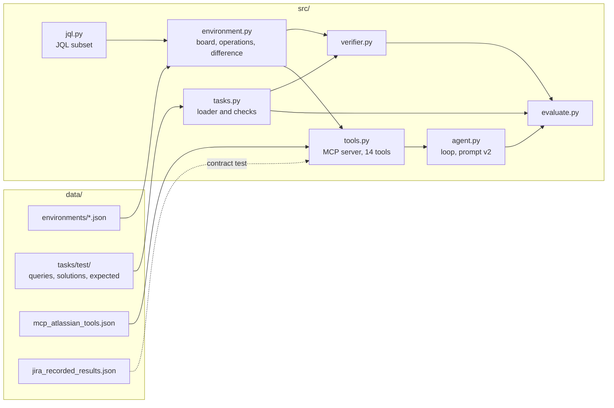
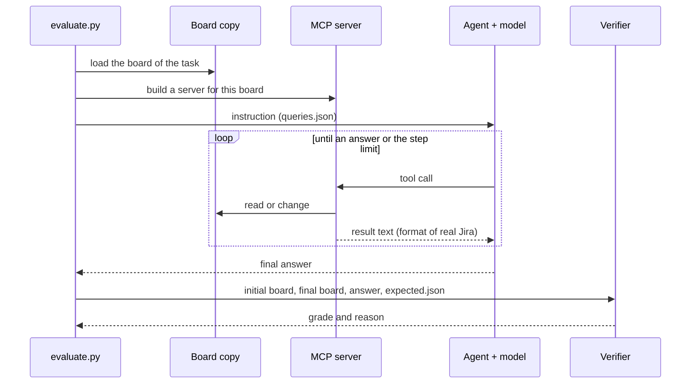
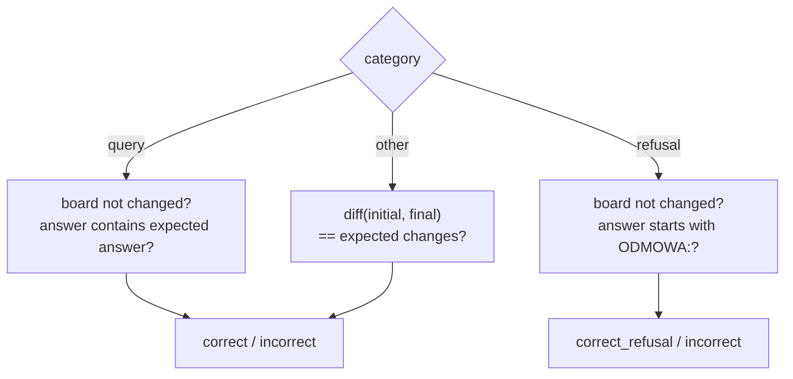

# Design

## Context

See `proposal.md` for the motivation. The facts that shape the design:

- The test set exists already: 5 boards in `data/environments/test-{web,app,api,data,ops}.json` and 200 tasks in `data/tasks/test/`. `docs/TASKS.md` gives the formats. The code must read these files without a change of the data.
- The tool contract is `data/mcp_atlassian_tools.json` (14 tools). The real results and errors are in `data/jira_recorded_results.json`. `docs/JIRA_TOOLS.md` lists the behavior of real Jira.
- The `.venv` has `mcp` 2.3.0. The low-level `mcp.server.lowlevel.Server` takes `on_list_tools` and `on_call_tool` handlers. `mcp.Client(server)` connects to it in the same process. Thus the server can give the exact JSON schemas from the file.
- The current code has 6 modules in `src/` for the old simulator. `src/agent.py` already has the loop, the backends and the trajectory. It changes only a little.

## Goals / Non-Goals

**Goals:**

- The model sees the same tools, the same result formats and the same errors on the simulator and on real Jira.
- The verifier grades all 200 test tasks, and each reference solution gets the grade `correct` or `correct_refusal`.
- The data files stay the source of truth. The code reads them and checks them.

**Non-Goals:**

- Copy the format conversion of the real server (Markdown to the Jira format and back). The simulator returns the text as it is stored. The contract test ignores the format of texts.
- Copy each field that the real server can return. The simulator returns the fields that the 14 tools return with the arguments that the tasks use.
- Speed. A board has about 40 issues.

## Overview

One evaluation of one task:

## Decisions

### D1. The data comes first, the code reads it

The change does not generate boards or tasks. `src/tasks.py` only loads and checks the files. The alternative (a generator in the code) gives text that the team cannot easily review, and the team rejected it.

### D2. Modules

| Module | Content | Change |
|---|---|---|
| `src/environment.py` | Pydantic models of the board file, load, operations, difference of two states | new content |
| `src/jql.py` | Parser and evaluation of the JQL subset | **new file** |
| `src/tools.py` | Low-level MCP server, the 14 tools, the result formats, the errors | new content |
| `src/tasks.py` | `Task` model, loader of the three files, checks | new content |
| `src/verifier.py` | Comparison of the difference with `expected.json`, answer checks | new content |
| `src/agent.py` | Prompt `v2`, default step limit 25 | small change |
| `src/evaluate.py` | Uses the new loader and verifier | small change |

`src/jql.py` is a new file because the JQL parser is about 200 lines and has its own tests. In `environment.py` it would make one long file with two different jobs.

### D3. Board model

The board file is the model. Pydantic models read it without a change of the keys (`account_id`, `display_name`, `issue_type`, `time_spent_seconds` and the other keys of `docs/TASKS.md`). The environment keeps the assignee, the reporter and the authors as account ids. The difference and the verifier use display names, because `expected.json` uses them.

Fixed values:

| Status | Category | Color in results | Transition id |
|---|---|---|---|
| `Backlog` | `To Do` | `blue-gray` | 11 |
| `In Progress` | `In Progress` | `yellow` | 21 |
| `In review` | `In Progress` | `yellow` | 31 |
| `Cancelled` | `In Progress` | `yellow` | 41 |
| `Done` | `Done` | `green` | 51 |

A new issue gets the id `max + 1`, the key `<KEY>-<max + 1>`, the status `Backlog`, the priority `Medium` (or the given one), the reporter = the first active person, and the time `now` of the board.

### D4. MCP server with the exact schemas

`build_server(board)` makes a `mcp.server.lowlevel.Server`. `on_list_tools` returns the 14 tools of `data/mcp_atlassian_tools.json` with `name`, `description`, `inputSchema` and `annotations` as in the file. `on_call_tool` finds the Python function of the tool and gives it the arguments. A function returns a JSON-compatible value, or raises `ToolError` with the message of the real server. The handler returns the JSON text (indent 2, `ensure_ascii=False`), or an error result with the text `Error calling tool '<name without jira_>': <message>`, as the real server does.

Alternative: `MCPServer` with typed Python functions. It makes its own schemas from the Python types, so the schemas are not equal to the file. Rejected.

The stand-alone mode stays: `python -m src.tools <board.json>` runs the server over stdio.

### D5. Result formats

The functions copy the keys and their order from `data/jira_recorded_results.json`:

| Tool | Result |
|---|---|
| `jira_search` | `{"total": -1, "start_at": 0, "max_results": <limit>, "issues": [issue]}`; the issue has `id`, `key`, `summary`, `browse_url` and the requested fields |
| `jira_get_issue` | one issue with the requested fields and `comments` (at most `comment_limit`) |
| `jira_search_assignable_users` | `{"success": true, "count": n, "users": [user]}` |
| `jira_get_agile_boards` | `[{"id", "name", "type"}]` |
| `jira_get_sprints_from_board` | `[{"id", "name", "state", "start_date", "end_date"}]`; a key without a value is left out; `goal` only when it is not empty |
| `jira_get_transitions` | `[{"id": 11, "name": "Backlog"}, ...]` |
| `jira_get_worklog` | `{"worklogs": [{"id", "comment", "created", "updated", "started", "time_spent", "time_spent_seconds", "author"}]}` |
| `jira_create_issue` | `{"message": "Issue created successfully", "issue": issue}` |
| `jira_update_issue` | `{"message": "Issue updated successfully", "issue": issue}` with `return_fields` |
| `jira_transition_issue` | `{"message": "Issue <key> transitioned successfully", "issue": issue}` |
| `jira_add_comment` | `{"id", "body", "created", "author"}` |
| `jira_add_worklog` | `{"message": "Worklog added successfully", "worklog": {...}}` |
| `jira_add_issues_to_sprint` | `{"message": "Successfully added <n> issue(s) to sprint", "sprint_id", "issue_keys": [...]}` |
| `jira_move_issues_to_backlog` | `{"message": "Successfully moved <n> issue(s) to backlog", "issue_keys": [...]}` |

An issue in a result: `status` = `{"name", "category", "color"}`, `issue_type` = `{"name"}`, `priority` = `{"name"}`, a person = `{"account_id", "display_name", "name", "email", "avatar_url"}`, no assignee = `{"display_name": "Unassigned"}`. The default `fields` is the value in the schema of the tool.

Dates: an issue date has the form `2026-11-02 23:55:34 CET`. A comment date and a worklog date have the form `2026-11-03 21:01:02.367000+01:00`. The recorded dates have the time zone of the computer of the server. The simulator uses one fixed form, so the results are the same on Windows and on Kaggle.

### D6. Errors

| Case | Error flag | Message |
|---|---|---|
| Unknown issue (read) | yes | `Issue <key> not found. Verify the issue key and project access.` |
| Unknown issue (change, comment) | yes | `... Issue does not exist or you do not have permission to see it.` (text of the recording) |
| JQL without a condition | yes | `Unbounded JQL queries are not allowed here. Please add a search restriction to your query.` |
| JQL syntax error | yes | `Error in JQL Query: <text>` |
| Unknown issue type | yes | `Specify a valid issue type` |
| Unknown priority | yes | `Failed to update issue <key>: Failed to update issue <key>: Specify the Priority (name) in the string format` |
| Unknown person (update) | yes | `Failed to update issue <key>: Failed to update issue <key>: Could not update assignee: Could not find account ID for user: <value>` |
| Unknown transition | yes | `Transition id '<id>' is not valid for this issue.` |
| Unknown sprint | yes | `We could not find the sprint` |
| Unknown person (create) | **no** | the issue is created without an assignee |
| Time that the tool cannot read | **no** | the worklog has 60 seconds |
| Translated status in JQL | **no** | empty result |

The implementation takes the exact texts from `data/jira_recorded_results.json`.

### D7. Persons

On 2026-11-04 we checked the real server on the Jira Cloud site:

- `assignee` works with the full display name or the e-mail. The comparison ignores case and Polish letters ("rudolf igor", "Robert Malysz" operate).
- A first name only ("Rudolf") or a surname only gives the error "Could not find account ID for user".
- `jira_search_assignable_users` finds a person when a word of the display name starts with the query ("Rud").

The simulator copies these rules. It folds Polish letters with a small fixed table (`ą→a`, `ł→l` and the other letters), so no new package is necessary. A person who is not active is not in any result and cannot be an assignee.

### D8. JQL subset

| Part | Support |
|---|---|
| Fields | `project`, `key`, `status`, `statusCategory`, `type` / `issuetype`, `priority`, `assignee`, `reporter`, `labels`, `sprint`, `summary`, `description`, `text` |
| Operators | `=`, `!=`, `IN (...)`, `NOT IN (...)`, `~`, `!~`, `IS EMPTY`, `IS NOT EMPTY` (also `NULL`) |
| Logic | `AND`, `OR`, `NOT`, parentheses |
| Functions | `openSprints()` (active only), `futureSprints()`, `closedSprints()` |
| Order | `ORDER BY key`, `created`, `updated`, `priority`, `status` with `ASC` / `DESC` |
| Values | text with or without quotation marks; the comparison ignores case |
| `assignee`, `reporter` | display name, e-mail or account id |
| `sprint` | sprint id or sprint name |
| `~` | each word of the value must be a whole word of the field; `text` = summary, description and comments |

Without `ORDER BY`, the result starts with the highest key. An unknown field gives a JQL error. A value that does not exist gives an empty result.

### D9. Difference and verifier

`diff(initial, final)` returns a list of changes in the format of `expected.json`. The verifier compares two lists as multisets after normalization:

| Item | Normalized key |
|---|---|
| Changed field | `(issue, field, value)`; labels as a sorted list; texts normalized |
| Comment | `(issue, normalized text)` |
| Worklog | `(issue, seconds)` and, when the expected comment is not `null`, the normalized comment |
| New issue | the expected fields only, with normalized texts; the key is not used |

A new issue that has comments in the expected result matches only with these comments. The reason of an `incorrect` grade names the missing and the additional items.

Answer checks (`query`): see the spec "Comparison of answers". A time in the answer is found with a regular expression for `<n>h <n>m`, `<n>,<n> h`, `<n> godzin(y)`, `<n> min(ut)`. The verifier takes all times and compares each one.

### D10. Loader and checks

`load_tasks(split)` reads the three files, joins them by `id` and returns a list of `Task` in the order of `queries.json`. It stops with an error that names the task id for the cases of the spec "Agreement of the task files". The tests check the other rules: the counts, the categories and difficulties, the keys of `easy` tasks, the separate splits and the checksums.

The test of the reference solutions applies each solution with the tools of `src/tools.py` (without an MCP client, as `apply_calls` does now) and grades the result with the verifier and the reference answer.

### D11. Contract test

The test builds a board in the test code with the content of the site at the time of the recording: the project `SCRUM`, the 4 issues `SCRUM-1` to `SCRUM-4`, the persons of the recording, the board 1 and the sprints 1 and 2. The issues that the recording made (`SCRUM-8` to `SCRUM-12`) get the same keys, because the test sets the next free number. For each recorded call, the test compares the error flag, the key structure and the messages. It ignores ids, dates, URLs, avatars and the order of keys. A call with a known difference (for example the Markdown format of a text) is in a short list of exceptions in the test, with the reason.

### D12. Prompt `v2` and the step limit

The prompt `v2` tells the model:

- to use only the tools, and to answer in Polish;
- that the names of statuses, issue types and priorities are in English (`In Progress`, `Bug`, `High`), and to find a person with `jira_search_assignable_users` before a change;
- to give numbers as digits;
- to start the answer with `ODMOWA:` when no tool can do the task, when the data does not exist, or when the request is not clear.

The default step limit changes from 15 to 25. A `bulk` task can need 2 calls for each of 6 issues and some reads.

### D13. Removal of the old data and code

The old boards (`data/environments/test-0*.json`, `train-*.json`), the old task files (`data/tasks/*/tasks.jsonl`) and their tests go away. The old job `baseline-v1` keeps its results in `jobs/runs/`. Its code is in git history.

## Risks / Trade-offs

- [The simulator differs from real Jira in a case that the tasks do not use] → The contract test covers the 43 recorded calls. Before E3, record more calls with the same procedure.
- [The checksum test fails on each correction of the test set before the freeze] → The checksums go into the test only at the freeze. Until then the checksum test is skipped with a clear reason.
- [The answer check is too strict or too lenient, for example for a time in words] → The tests of the verifier use the reference answers of all 200 tasks and some wrong answers. The error analysis of the baseline shows the remaining cases.
- [The exact comment match fails for a correct comment with other words] → The instructions give the comment text after a colon. If the baseline shows many such failures, a later change can make the match more lenient. That change must run all variants again.
- [Polish letters in names in JQL, for example `assignee = "Lukasz Ostrowski"`] → Not checked on real Jira. The simulator ignores Polish letters, as the update tool does.

## Migration Plan

1. Implement the modules on the branch `e1-jira-tasks`.
2. The test of the reference solutions passes for all 200 tasks.
3. The team reviews the test set. The corrections go into the data files, and the tests run again.
4. Freeze the test set: add the checksums to the test.
5. Run the new baseline in a separate job.

Rollback: the old system is on `main` until the merge of this branch.

## Open Questions

- Real Jira and times such as `1,5h` or `1.5h` in `jira_add_worklog`. The simulator reads `<n>w`, `<n>d`, `<n>h`, `<n>m` with whole numbers, and logs 60 seconds for other text. A check on the site can correct this rule later without a change of the tasks, because the reference solutions use the Jira format.
- Real Jira and Polish letters in `jira_search_assignable_users` ("Lukasz" for "Łukasz"). The simulator ignores them.
